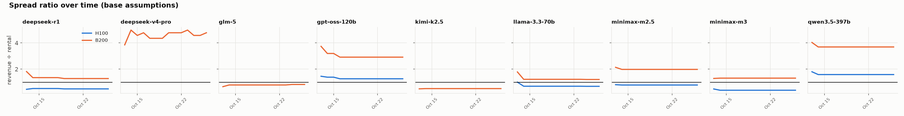

# Token Spread — report 2026-10-26

*Generated by `report.py` from `outputs/` (data retrieved 2026-10-26). Re-run: see README.*

**Question.** What does a GPU-hour earn when it serves open-weight LLM tokens at market API
prices, compared with what that GPU-hour rents for — and does that tell us something rental
indices don't?

**Base assumptions** (`assumptions.yaml`): input:output = 8:1,
utilization = 60%, throughput = best benchmark point with
≥ 30 tok/s per user, price = median
OpenRouter provider, rental = `silicondata_index_faq`.

## Headlines

- Lowest base-case ratio: **minimax-m3 on H100** at 0.40×
  (breakeven utilization 152%).
- Highest ratio: **qwen3.5-397b on B200 fp4** at 5.34×.
- B200 rents for 2.15× an H100, but at the same precision the token-implied value of a B200-hour is
  3.8×–7.2× an H100-hour, depending on the model (chart 3).

## 1. Summary table

| model | GPU | case | providers | blended $/Mtok (min–med–max) | tok/s/GPU | tok/s/GPU (max) | revenue $/h | rental $/h | spread $/h | ratio | breakeven util | bench date |
|---|---|---|---|---|---|---|---|---|---|---|---|---|
| llama-3.3-70b | H100 fp8 | base | 10 | 0.12–0.51–0.72 | 1607 | 2568 | $1.75 | $2.53 | −$0.78 | 0.69× | 87% | 2025-10-29 |
| llama-3.3-70b | B200 fp8 | base | 10 | 0.12–0.51–0.72 | 6062 | 9421 | $6.62 | $5.45 | $1.17 | 1.21× | 49% | 2025-10-29 |
| llama-3.3-70b | B200 fp4 | variant | 10 | 0.12–0.51–0.72 | 9366 | 12981 | $10.22 | $5.45 | $4.77 | 1.88× | 32% | 2025-10-29 |
| gpt-oss-120b | H100 fp4 | base | 24 | 0.04–0.14–0.39 | 10284 | 10284 | $3.21 | $2.53 | $0.68 | 1.27× | 47% | 2026-03-27,2026-05-17 |
| gpt-oss-120b | B200 fp4 | base | 24 | 0.04–0.14–0.39 | 50934 | 65459 | $15.89 | $5.45 | $10.44 | 2.92× | 21% | 2026-02-05,2026-05-18 |
| qwen3.5-397b | H100 fp8 | base | 10 | 0.61–0.88–1.17 | 2120 | 2561 | $4.02 | $2.53 | $1.49 | 1.59× | 38% | 2026-07-05,2026-09-13 |
| qwen3.5-397b | B200 fp8 | base | 10 | 0.61–0.88–1.17 | 10612 | 12951 | $20.12 | $5.45 | $14.67 | 3.69× | 16% | 2026-03-20,2026-07-05,2026-09-18 |
| qwen3.5-397b | B200 fp4 | variant | 10 | 0.61–0.88–1.17 | 15347 | 20571 | $29.10 | $5.45 | $23.65 | 5.34× | 11% | 2026-06-24,2026-10-20 |
| minimax-m3 | H100 fp8 | base | 13 | 0.30–0.40–0.80 | 1158 | 1158 | $1.00 | $2.53 | −$1.53 | 0.40× | 152% | 2026-06-13 |
| minimax-m3 | B200 fp8 | base | 13 | 0.30–0.40–0.80 | 8309 | 8556 | $7.18 | $5.45 | $1.73 | 1.32× | 46% | 2026-06-23,2026-07-29 |
| minimax-m3 | B200 fp4 | variant | 13 | 0.30–0.40–0.80 | 9918 | 11671 | $8.57 | $5.45 | $3.12 | 1.57× | 38% | 2026-07-06,2026-08-04 |
| deepseek-r1 | H100 fp8 | base | 3 | 0.68–0.69–0.76 | 850 | 850 | $1.26 | $2.53 | −$1.27 | 0.50× | 120% | 2026-02-08,2026-02-13 |
| deepseek-r1 | B200 fp8 | base | 3 | 0.68–0.69–0.76 | 4724 | 5857 | $7.01 | $5.45 | $1.56 | 1.29× | 47% | 2026-02-05,2026-03-23 |
| deepseek-r1 | B200 fp4 | variant | 3 | 0.68–0.69–0.76 | 12147 | 13430 | $18.02 | $5.45 | $12.57 | 3.31× | 18% | 2026-01-29,2026-02-06 |
| minimax-m2.5 | H100 fp8 | base | 8 | 0.35–0.40–0.80 | 2322 | 2957 | $2.01 | $2.53 | −$0.52 | 0.79× | 76% | 2026-03-28,2026-06-04 |
| minimax-m2.5 | B200 fp8 | base | 8 | 0.35–0.40–0.80 | 12509 | 12509 | $10.81 | $5.45 | $5.36 | 1.98× | 30% | 2026-03-28,2026-05-31,2026-06-03 |
| minimax-m2.5 | B200 fp4 | variant | 8 | 0.35–0.40–0.80 | 20353 | 20353 | $17.59 | $5.45 | $12.14 | 3.23× | 19% | 2026-06-03 |
| deepseek-v4-pro | B200 fp4 | base | 16 | 0.89–1.51–2.12 | 7983 | 9734 | $26.02 | $5.45 | $20.57 | 4.77× | 13% | 2026-06-12,2026-08-12 |
| glm-5 | B200 fp8 | base | 9 | 0.75–1.24–1.51 | 1694 | 3682 | $4.55 | $5.45 | −$0.90 | 0.84× | 72% | 2026-03-20,2026-05-18,2026-06-12 |
| glm-5 | B200 fp4 | variant | 9 | 0.75–1.24–1.51 | 3022 | 4134 | $8.12 | $5.45 | $2.67 | 1.49× | 40% | 2026-06-12 |
| kimi-k2.5 | B200 int4 | base | 5 | 0.71–0.82–0.87 | 1594 | 2299 | $2.84 | $5.45 | −$2.61 | 0.52× | 115% | 2026-03-24,2026-07-05,2026-07-18 |
| kimi-k2.5 | B200 fp4 | variant | 5 | 0.71–0.82–0.87 | 14368 | 16602 | $25.55 | $5.45 | $20.10 | 4.69× | 13% | 2026-03-27,2026-06-07,2026-07-22 |

`tok/s/GPU` = total (input+output) tokens/s per GPU at the base in:out ratio, interactivity-floor
point; `(max)` = highest throughput with no latency floor. Breakeven util = utilization at
which revenue = rental. Rows with `estimate=True` in `outputs/spread_summary.csv` use
interpolated throughput (see section 10).

## 2. Sensitivity: utilization × input:output ratio

Full grid (also with the max-throughput operating point): `outputs/sensitivity.csv`.

## 3. B200 vs H100 relative value

If rental markets priced GPUs by the tokens they produce, the dots would sit on the rental-ratio
lines. Dots to the right mean B200 is cheap relative to H100 for that model (or H100 is dear).

## 4. Provider dispersion (base case, one rental price, many API prices)

| model | GPU | cheapest provider | most expensive | providers above breakeven |
|---|---|---|---|---|
| deepseek-r1 | B200 | DeepInfra (fp4) 1.28× | StreamLake (unknown) 1.43× | 3/3 |
| deepseek-r1 | H100 | DeepInfra (fp4) 0.50× | StreamLake (unknown) 0.55× | 0/3 |
| deepseek-v4-pro | B200 | StreamLake (fp8) 2.80× | Azure (unknown) 6.72× | 16/16 |
| glm-5 | B200 | GMICloud (fp8) 0.50× | Venice (unknown) 1.01× | 1/9 |
| gpt-oss-120b | B200 | Near AI (fp4) 0.87× | Cerebras (fp16) 7.96× | 19/24 |
| gpt-oss-120b | H100 | Venice (int4) 0.38× | Cerebras (fp16) 3.46× | 14/24 |
| kimi-k2.5 | B200 | AtlasCloud (int4) 0.45× | Amazon Bedrock (unknown) 0.55× | 0/5 |
| llama-3.3-70b | B200 | DeepInfra (fp8) 0.30× | Google (unknown) 1.73× | 6/10 |
| llama-3.3-70b | H100 | DeepInfra (fp8) 0.17× | Google (unknown) 0.99× | 0/10 |
| minimax-m2.5 | B200 | Venice (unknown) 1.71× | Minimax (fp8) 3.97× | 8/8 |
| minimax-m2.5 | H100 | Venice (unknown) 0.68× | Minimax (fp8) 1.59× | 1/8 |
| minimax-m3 | B200 | DeepInfra (fp8) 0.98× | Mara (unknown) 2.63× | 12/13 |
| minimax-m3 | H100 | DeepInfra (fp8) 0.29× | Mara (unknown) 0.79× | 0/13 |
| qwen3.5-397b | B200 | Alibaba (unknown) 2.55× | Venice (unknown) 4.91× | 10/10 |
| qwen3.5-397b | H100 | Alibaba (unknown) 1.10× | Venice (unknown) 2.11× | 10/10 |

Full table: `outputs/provider_spread.csv`.

## 5. Rental prices used

| gpu | series | price | method | estimate | notes |
|---|---|---|---|---|---|
| h100 | silicondata_index_faq | $2.53 | scraped | False | FAQ text on index page (SDH100RT, neocloud on-demand) |
| h100 | silicondata_index_widget | $2.89 | scraped | False | 'Related indices' widget, ticker SDH100RT, 7D change 6.2% |
| b200 | silicondata_index_faq | $5.45 | scraped | False | FAQ text on index page (SDB200RT, neocloud on-demand) |
| b200 | silicondata_index_widget | $6.60 | scraped | False | 'Related indices' widget, ticker SDB200RT, 7D change 12.4% |
| h100 | inferencex_retail | $2.00 | fetched | True | InferenceX 'retail tier' $/GPU-hr assumption (SemiAnalysis TCO model); modelled, not a market quote |
| h100 | inferencex_owner_tco | $1.17 | fetched | True | InferenceX 'owning at hyperscaler volume' $/GPU-hr (all-in TCO, not a rental price); modelled, not a market quote |
| b200 | inferencex_retail | $3.70 | fetched | True | InferenceX 'retail tier' $/GPU-hr assumption (SemiAnalysis TCO model); modelled, not a market quote |
| b200 | inferencex_owner_tco | $1.73 | fetched | True | InferenceX 'owning at hyperscaler volume' $/GPU-hr (all-in TCO, not a rental price); modelled, not a market quote |

## 6. Price-only models: breakeven throughput and price comparison

Closed models (Claude, GPT, Grok, Gemini, Meta Muse) publish prices but not their hardware or throughput, and some
open-weight models have no comparable benchmark yet (only agentic traces, or no runs). No
spread is computed for them. Instead: how many tokens/s per GPU would a model need for its
**list price** to cover the GPU's rent at 60% utilization?
`needed = rent ÷ (3600 × utilization × blended price / 1e6)`. For open-weight models this is
the same breakeven, and spread ratio = measured ÷ needed.

- **claude-fable-5.1** at $14.44/Mtok needs only **81 tok/s per H100**.
  The slowest open-weight model measured here manages 850.
- **deepseek-v4.1-flash** at $0.13/Mtok needs **9,088 tok/s per H100**
  (19,576 per B200). 1 of 6.0 benchmarked models reaches that on H100.
- These are thresholds, not estimates of closed-model throughput or margin. Closed labs may
  run other hardware (TPUs, Trainium, own clusters), bill hidden reasoning tokens as output,
  and discount cached input heavily.

| model | lab | weights | blended $/Mtok | needed tok/s per H100 | needed tok/s per B200 | benchmarked models above (H100, of 6.0) | benchmarked models above (B200, of 9.0) |
|---|---|---|---|---|---|---|---|
| claude-fable-5.1 | Anthropic | closed | $14.44 | 81 | 175 | 6 | 9 |
| gpt-6-astra | OpenAI | closed | $14.44 | 81 | 175 | 6 | 9 |
| muse-wonder | Meta | closed | $5.78 | 203 | 437 | 6 | 9 |
| claude-opus-5.5 | Anthropic | closed | $5.78 | 203 | 437 | 6 | 9 |
| gpt-6.1-sol | OpenAI | closed | $2.89 | 405 | 873 | 6 | 9 |
| claude-sonnet-5.5 | Anthropic | closed | $2.89 | 405 | 873 | 6 | 9 |
| gemini-4-argon | Google | closed | $2.89 | 405 | 873 | 6 | 9 |
| grok-4.7 | xAI | closed | $2.44 | 479 | 1,032 | 6 | 9 |
| kimi-k3 | Moonshot | open | $2.36 | 497 | 1,070 | 6 | 9 |
| muse-spark-1.3 | Meta | closed | $1.58 | 740 | 1,594 | 6 | 9 |
| gemini-3.8-flash | Google | closed | $1.19 | 983 | 2,117 | 5 | 7 |
| grok-build-0.1 | xAI | closed | $1.11 | 1,054 | 2,271 | 5 | 7 |
| glm-5.2 | Zhipu | open | $0.81 | 1,449 | 3,122 | 4 | 7 |
| gemini-3.5-flash-lite | Google | closed | $0.54 | 2,151 | 4,634 | 2 | 7 |
| qwen3.8-27b | Qwen | open | $0.46 | 2,571 | 5,539 | 1 | 6 |
| muse-glimmer-30b | Meta | open | $0.40 | 2,928 | 6,308 | 1 | 5 |
| qwen3.8-flash-next | Qwen | open | $0.19 | 6,312 | 13,598 | 1 | 1 |
| claude-haiku-5.5 | Anthropic | closed | $0.14 | 8,109 | 17,468 | 1 | 1 |
| gpt-6-luna | OpenAI | closed | $0.14 | 8,109 | 17,468 | 1 | 1 |
| deepseek-v4.1-flash | DeepSeek | open | $0.13 | 9,088 | 19,576 | 1 | 1 |

**Price comparison** (blended at 8:1; price-only = OpenRouter list price,
benchmarked open-weight = median provider):

| model | weights | analysis | lab | blended $/Mtok | endpoint range | basis |
|---|---|---|---|---|---|---|
| claude-fable-5.1 | closed | price-only | Anthropic | $14.444 | $14.444–$14.444 | OpenRouter list price |
| gpt-6-astra | closed | price-only | OpenAI | $14.444 | $7.222–$86.667 | OpenRouter list price |
| claude-opus-5.5 | closed | price-only | Anthropic | $5.778 | $5.778–$11.556 | OpenRouter list price |
| muse-wonder | closed | price-only | Meta | $5.778 | $5.778–$5.778 | OpenRouter list price |
| claude-sonnet-5.5 | closed | price-only | Anthropic | $2.889 | $2.889–$3.178 | OpenRouter list price |
| gemini-4-argon | closed | price-only | Google | $2.889 | $1.444–$5.200 | OpenRouter list price |
| gpt-6.1-sol | closed | price-only | OpenAI | $2.889 | $1.444–$17.333 | OpenRouter list price |
| grok-4.7 | closed | price-only | xAI | $2.444 | $2.444–$4.889 | OpenRouter list price |
| kimi-k3 | open | price-only | Moonshot | $2.357 | $1.057–$6.500 | OpenRouter list price |
| muse-spark-1.3 | closed | price-only | Meta | $1.583 | $1.583–$1.583 | OpenRouter list price |
| deepseek-v4-pro | open | spread | open-weight | $1.509 | $0.886–$2.123 | median OpenRouter provider |
| glm-5 | open | spread | open-weight | $1.244 | $0.747–$1.511 | median OpenRouter provider |
| gemini-3.8-flash | closed | price-only | Google | $1.192 | $0.542–$1.950 | OpenRouter list price |
| grok-build-0.1 | closed | price-only | xAI | $1.111 | $1.111–$2.222 | OpenRouter list price |
| qwen3.5-397b | open | spread | open-weight | $0.878 | $0.607–$1.167 | median OpenRouter provider |
| kimi-k2.5 | open | spread | open-weight | $0.823 | $0.713–$0.867 | median OpenRouter provider |
| glm-5.2 | open | price-only | Zhipu | $0.808 | $0.560–$2.876 | OpenRouter list price |
| deepseek-r1 | open | spread | open-weight | $0.687 | $0.683–$0.762 | median OpenRouter provider |
| gemini-3.5-flash-lite | closed | price-only | Google | $0.544 | $0.272–$0.980 | OpenRouter list price |
| llama-3.3-70b | open | spread | open-weight | $0.505 | $0.124–$0.720 | median OpenRouter provider |
| qwen3.8-27b | open | price-only | Qwen | $0.456 | $0.174–$1.046 | OpenRouter list price |
| minimax-m2.5 | open | spread | open-weight | $0.400 | $0.346–$0.800 | median OpenRouter provider |
| minimax-m3 | open | spread | open-weight | $0.400 | $0.297–$0.800 | median OpenRouter provider |
| muse-glimmer-30b | open | price-only | Meta | $0.400 | $0.400–$0.478 | OpenRouter list price |
| qwen3.8-flash-next | open | price-only | Qwen | $0.186 | $0.186–$0.186 | OpenRouter list price |
| gpt-6-luna | closed | price-only | OpenAI | $0.144 | $0.072–$0.289 | OpenRouter list price |
| claude-haiku-5.5 | closed | price-only | Anthropic | $0.144 | $0.144–$0.159 | OpenRouter list price |
| gpt-oss-120b | open | spread | open-weight | $0.144 | $0.043–$0.394 | median OpenRouter provider |
| deepseek-v4.1-flash | open | price-only | DeepSeek | $0.129 | $0.100–$0.800 | OpenRouter list price |

## 7. From electricity to tokens

A GPU-hour's cost starts with electricity. Each GPU draws its **all-in** power (chip plus its
share of host CPU, memory and network; SemiAnalysis: H100 1.37 kW,
B200 1.71 kW), and the facility adds cooling and conversion losses
(PUE 1.3). `power cost per GPU-hour = all-in kW × load factor (0.8) × PUE × $/kWh`.

At the base region (U.S. average (industrial), $0.096/kWh):

- Electricity costs **$0.14 per H100-hour** and
  **$0.17 per B200-hour**: 5.4%
  and 3.1% of the rent, and about
  12% / 10% of the owner's full cost (SemiAnalysis TCO).
- Across regions ($0.072–$0.201/kWh),
  power is 2.4%–11.3% of rent.
- Turned into tokens and sold at market prices, one kWh earns
  $0.70–$14.63: **7–152×**
  what the electricity cost.
- Measured GPU draw (newer InferenceX runs only) is 71%–97% of
  TDP at the chosen operating points, so the full-load assumption is conservative.

| model | GPU | power $/h | owner TCO $/h | rent $/h | revenue $/h | tokens per kWh | revenue per kWh | revenue ÷ power | measured GPU W (% TDP) |
|---|---|---|---|---|---|---|---|---|---|
| llama-3.3-70b | H100 fp8 | $0.14 | $1.17 | $2.53 | $1.75 | 2.44M | $1.23 | 13× | – |
| llama-3.3-70b | B200 fp8 | $0.17 | $1.73 | $5.45 | $6.62 | 7.36M | $3.72 | 39× | – |
| gpt-oss-120b | H100 fp4 | $0.14 | $1.17 | $2.53 | $3.21 | 15.59M | $2.25 | 23× | – |
| gpt-oss-120b | B200 fp4 | $0.17 | $1.73 | $5.45 | $15.89 | 61.86M | $8.94 | 93× | – |
| qwen3.5-397b | H100 fp8 | $0.14 | $1.17 | $2.53 | $4.02 | 3.21M | $2.82 | 29× | 498 (71%) |
| qwen3.5-397b | B200 fp8 | $0.17 | $1.73 | $5.45 | $20.12 | 12.89M | $11.31 | 117× | 969 (97%) |
| minimax-m3 | H100 fp8 | $0.14 | $1.17 | $2.53 | $1.00 | 1.76M | $0.70 | 7× | 582 (83%) |
| minimax-m3 | B200 fp8 | $0.17 | $1.73 | $5.45 | $7.18 | 10.09M | $4.04 | 42× | 888 (89%) |
| deepseek-r1 | H100 fp8 | $0.14 | $1.17 | $2.53 | $1.26 | 1.29M | $0.88 | 9× | – |
| deepseek-r1 | B200 fp8 | $0.17 | $1.73 | $5.45 | $7.01 | 5.74M | $3.94 | 41× | – |
| minimax-m2.5 | H100 fp8 | $0.14 | $1.17 | $2.53 | $2.01 | 3.52M | $1.41 | 15× | 514 (73%) |
| minimax-m2.5 | B200 fp8 | $0.17 | $1.73 | $5.45 | $10.81 | 15.19M | $6.08 | 63× | – |
| deepseek-v4-pro | B200 fp4 | $0.17 | $1.73 | $5.45 | $26.02 | 9.70M | $14.63 | 152× | – |
| glm-5 | B200 fp8 | $0.17 | $1.73 | $5.45 | $4.55 | 2.06M | $2.56 | 27× | – |
| kimi-k2.5 | B200 int4 | $0.17 | $1.73 | $5.45 | $2.84 | 1.94M | $1.59 | 17× | 821 (82%) |

**Electricity cost per GPU-hour by region** (EIA: latest month, by sector; Eurostat:
MWH70000-149999 kWh/yr band, excl. VAT, converted at the ECB rate):

| region | $/kWh | period | H100 power $/h | B200 power $/h | share of H100 rent | share of B200 rent |
|---|---|---|---|---|---|---|
| Texas | $0.072 | August 2026 | $0.10 | $0.13 | 4.1% | 2.4% |
| Washington | $0.074 | August 2026 | $0.11 | $0.13 | 4.2% | 2.4% |
| Norway | $0.080 | 2026-S1 | $0.11 | $0.14 | 4.5% | 2.6% |
| Oregon | $0.087 | August 2026 | $0.12 | $0.16 | 4.9% | 2.9% |
| Finland | $0.089 | 2026-S1 | $0.13 | $0.16 | 5.0% | 2.9% |
| France | $0.089 | 2026-S1 | $0.13 | $0.16 | 5.0% | 2.9% |
| U.S. average (industrial) | $0.096 | August 2026 | $0.14 | $0.17 | 5.4% | 3.1% |
| Arizona | $0.097 | August 2026 | $0.14 | $0.17 | 5.5% | 3.2% |
| Ohio | $0.098 | August 2026 | $0.14 | $0.17 | 5.5% | 3.2% |
| Virginia | $0.100 | August 2026 | $0.14 | $0.18 | 5.6% | 3.3% |
| Sweden | $0.100 | 2026-S1 | $0.14 | $0.18 | 5.7% | 3.3% |
| Spain | $0.103 | 2026-S1 | $0.15 | $0.18 | 5.8% | 3.3% |
| Georgia | $0.131 | August 2026 | $0.19 | $0.23 | 7.3% | 4.3% |
| Netherlands | $0.140 | 2026-S1 | $0.20 | $0.25 | 7.9% | 4.6% |
| U.S. average (commercial) | $0.145 | August 2026 | $0.21 | $0.26 | 8.1% | 4.7% |
| Germany | $0.154 | 2026-S1 | $0.22 | $0.27 | 8.7% | 5.0% |
| Ireland | $0.201 | 2026-S1 | $0.29 | $0.36 | 11.3% | 6.6% |

## 8. Who makes the money: the GPU rental firm

Electricity is not most of a GPU rental firm's cost. Owning a GPU for one hour costs:
`hardware (depreciation + financing) + data-centre space + electricity + operations`.
Hardware and its financing are 61%–67% of the total.
The firm collects rent only for the share of hours a customer is using the GPU (occupancy,
80% here).

| per GPU-hour | H100 | B200 |
|---|---|---|
| Hardware depreciation | $0.68 | $1.07 |
| Financing | $0.26 | $0.40 |
| Data-centre space | $0.37 | $0.46 |
| Electricity | $0.14 | $0.17 |
| Operations | $0.10 | $0.10 |
| **Full cost** | $1.54 | $2.21 |
| Revenue (rent × 80%) | $2.02 | $4.36 |
| **Profit** | $0.48 | $2.15 |
| Margin before depreciation & interest (EBITDA) | 70% | 83% |
| Operating margin | 37% | 59% |
| Net margin | 24% | 49% |
| Occupancy needed to break even | 61% | 40% |
| Payback on hardware (years) | 2.9 | 1.8 |
| SemiAnalysis owner cost (cross-check) | $1.17 | $1.73 |

Assumptions (`assumptions.yaml` → `rental_firm`): capex per GPU = 8-GPU server ÷ 8, straight-line
over 6 years, financed at 10% (annuity), colocation
$196.25/kW-month on all-in kW, operations $0.10/GPU-hour.

**Profit by occupancy** (6-year depreciation):

| occupancy | H100 profit $/h | B200 profit $/h |
|---|---|---|
| 50% | −$0.27 | $0.52 |
| 60% | −$0.02 | $1.06 |
| 70% | $0.23 | $1.61 |
| 80% | $0.48 | $2.15 |
| 90% | $0.74 | $2.70 |
| 100% | $0.99 | $3.24 |

**Reality check: CoreWeave, Q2 2026.** Revenue $2,575M; adjusted EBITDA
margin 59%; depreciation 54%
and interest 25% of revenue; operating margin
-2%. The model's EBITDA margins are in the same range, but its
operating margins are far higher. A fast-growing firm pays depreciation and interest on capacity
before it earns revenue, sells mostly on multi-year contracts below on-demand prices, and carries
overheads (sales, R&D, stock compensation) that this per-GPU model leaves out.

**Where one rented GPU-hour of token revenue goes** (base cases): the GPU landlord's costs and
profit add up to the rent; the inference provider keeps token revenue minus rent (the token
spread). An operator that owns its GPUs and sells tokens keeps token revenue minus full cost.

| model | GPU | landlord costs $/h | landlord profit $/h | rent $/h | token revenue $/h | inference provider profit $/h | own-and-serve profit $/h | full cost per M tokens | price per M tokens |
|---|---|---|---|---|---|---|---|---|---|
| llama-3.3-70b | H100 | $1.92 | $0.61 | $2.53 | $1.75 | −$0.78 | $0.22 | $0.443 | $0.505 |
| llama-3.3-70b | B200 | $2.76 | $2.69 | $5.45 | $6.62 | $1.17 | $4.41 | $0.168 | $0.505 |
| gpt-oss-120b | H100 | $1.92 | $0.61 | $2.53 | $3.21 | $0.68 | $1.67 | $0.069 | $0.144 |
| gpt-oss-120b | B200 | $2.76 | $2.69 | $5.45 | $15.89 | $10.44 | $13.69 | $0.020 | $0.144 |
| qwen3.5-397b | H100 | $1.92 | $0.61 | $2.53 | $4.02 | $1.49 | $2.48 | $0.336 | $0.878 |
| qwen3.5-397b | B200 | $2.76 | $2.69 | $5.45 | $20.12 | $14.67 | $17.91 | $0.096 | $0.878 |
| minimax-m3 | H100 | $1.92 | $0.61 | $2.53 | $1.00 | −$1.53 | −$0.54 | $0.616 | $0.400 |
| minimax-m3 | B200 | $2.76 | $2.69 | $5.45 | $7.18 | $1.73 | $4.97 | $0.123 | $0.400 |
| deepseek-r1 | H100 | $1.92 | $0.61 | $2.53 | $1.26 | −$1.27 | −$0.28 | $0.838 | $0.687 |
| deepseek-r1 | B200 | $2.76 | $2.69 | $5.45 | $7.01 | $1.56 | $4.80 | $0.216 | $0.687 |
| minimax-m2.5 | H100 | $1.92 | $0.61 | $2.53 | $2.01 | −$0.52 | $0.47 | $0.307 | $0.400 |
| minimax-m2.5 | B200 | $2.76 | $2.69 | $5.45 | $10.81 | $5.36 | $8.60 | $0.082 | $0.400 |
| deepseek-v4-pro | B200 | $2.76 | $2.69 | $5.45 | $26.02 | $20.57 | $23.81 | $0.128 | $1.509 |
| glm-5 | B200 | $2.76 | $2.69 | $5.45 | $4.55 | −$0.90 | $2.35 | $0.603 | $1.244 |
| kimi-k2.5 | B200 | $2.76 | $2.69 | $5.45 | $2.84 | −$2.61 | $0.63 | $0.640 | $0.823 |

**Sources used in the firm model:**

| item | gpu | value | unit | low | high | estimate | source |
|---|---|---|---|---|---|---|---|
| server_price_8gpu | h100 | 285000.0 | USD per 8-GPU server | 250000.0 | 320000.0 | True | [link](https://www.mercatus-ai.com/blog/h100-server-price) |
| server_price_8gpu | b200 | 450000.0 | USD per 8-GPU server | 400000.0 | 500000.0 | True | [link](https://www.mercatus-ai.com/blog/b200-server-price) |
| depreciation_years | all | 6.0 | years | 4.0 | 6.0 | True | [link](https://capefearadvisors.substack.com/p/the-second-contract) |
| cost_of_capital | all | 0.1 | annual rate | 0.059 | 0.15 | True | [link](https://investors.coreweave.com/news/news-details/2026/CoreWeave-Announces-Pricing-of-1-25-Billion-of-Senior-Notes-and-2-Billion-of-Senior-Notes/default.aspx) |
| colocation_per_kw_month | all | 196.25 | USD per kW-month | 165.0 | 235.0 | False | [link](https://www.cbre.com/insights/books/north-america-data-center-trends-h2-2025) |
| ops_per_gpu_hour | all | 0.1 | USD per GPU-hour | 0.07 | 0.15 | True | [link](https://www.mercatus-ai.com/blog/h100-server-price) |
| occupancy | all | 0.8 | share of hours rented | 0.5 | 1.0 | True | [link](https://www.mercatus-ai.com/blog/h100-server-price) |

## 9. Over time

## 10. Data gaps and caveats

**Gaps found this run**

- **llama-3.3-70b on H100**: newest benchmark is 2025-10-29 (>6 months old; software has improved since, so throughput is likely understated).
- **llama-3.3-70b on B200**: newest benchmark is 2025-10-29 (>6 months old; software has improved since, so throughput is likely understated).
- **deepseek-r1 on H100**: newest benchmark is 2026-02-13 (>6 months old; software has improved since, so throughput is likely understated).
- **deepseek-r1 on B200**: newest benchmark is 2026-03-23 (>6 months old; software has improved since, so throughput is likely understated).
- **deepseek-v4-pro on H100**: no InferenceX benchmark on this GPU; the model appears on the other GPU only.
- **deepseek-v4-pro on B200**: benchmarked at fp4, but most providers report serving fp8.
- **glm-5 on H100**: no InferenceX benchmark on this GPU; the model appears on the other GPU only.
- **kimi-k2.5 on H100**: no InferenceX benchmark on this GPU; the model appears on the other GPU only.
- **Sweep edges:** 12 of 30 chosen benchmark points are the last point of their concurrency sweep and still well above the speed floor. The benchmark stopped before reaching the floor, so throughput there is a lower bound.
- **deepseek-v4.1-flash** (open-weight): agentic benchmarks only; shown as price-only.
- **kimi-k3** (open-weight): agentic benchmarks only; shown as price-only.
- **glm-5.2** (open-weight): agentic benchmarks only; shown as price-only.
- **qwen3.8-flash-next** (open-weight): agentic benchmarks only; shown as price-only.
- **qwen3.8-27b** (open-weight): no benchmark runs yet; shown as price-only.
- **muse-glimmer-30b** (open-weight): no InferenceX benchmark; shown as price-only.
- **No 8B-class model**: InferenceX doesn't benchmark one, so there is no comparable throughput.
- Providers with **unknown quantization** on OpenRouter: deepseek-r1 1, deepseek-v4-pro 5, glm-5 2, gpt-oss-120b 9, kimi-k2.5 3, llama-3.3-70b 4, minimax-m2.5 3, minimax-m3 2, qwen3.5-397b 6.
  They are included in the price statistics regardless of precision.

**Caveats**

- **Throughput dominates.** The interactivity floor alone moves results by up to several ×
  (compare `tok/s/GPU` with `(max)`). Benchmarks use random tokens and fixed lengths, with no
  prefix-cache hits, no traffic burstiness and no long-context tail.
- **Only 1:1 and 8:1 are measured.** InferenceX measures 1k/1k (1:1) and 8k/1k (8:1).
  3:1 is log-interpolated and 10:1 is held at 8:1. The 1:1 and 8:1 points can come from
  different dates and software versions.
- **Cached input is not priced.** Agent traffic is ~100:1 input:output with ~90% of prompt
  tokens served from cache at a discount (OpenRouter, Oct 2026), and caching also speeds up the
  GPU. Neither effect is modelled.
- **Configurations differ across GPUs.** The best point may use speculative decoding (MTP) on
  one GPU and not the other, and some points (e.g. DeepSeek-R1 on H100) need multi-node
  disaggregated serving. These are the best published configurations, not matched ones.
- **Prices are list prices.** OpenRouter shows public per-token prices only, without volume
  deals, batch discounts or cache-hit pricing. Precision is not matched per provider: the
  median is across all providers, and an fp4 provider counts the same as a bf16 one.
- **Rental is a standardized index.** Silicon Data's index (mainly neoclouds, normalised for
  terms) is not a term-contract quote. Its public page shows two different readings
  (FAQ vs widget; both are recorded). Term contracts and hyperscalers price differently.
  InferenceX's owner-TCO figures (H100 $1.17,
  B200 $1.73) are a floor for what serving
  costs an owner-operator.
- **Electricity is modelled, not metered.** Power cost uses SemiAnalysis all-in kW per GPU at
  an assumed average draw (80% of all-in), an assumed PUE and average published tariffs. Large operators buy power through
  contracts (PPAs) whose prices are not public, and pay demand charges not captured here.
- **The rental-firm model is generic.** Server prices are vendor estimates (NVIDIA publishes no
  list price), depreciation life and financing cost vary by firm, and real fleets mix contract
  and on-demand prices. It leaves out sales, R&D and corporate overheads.
- **Revenue ≠ margin.** The spread excludes networking, storage, CPU hosts, engineering,
  idle capacity reserved for peaks, and OpenRouter's fee.
