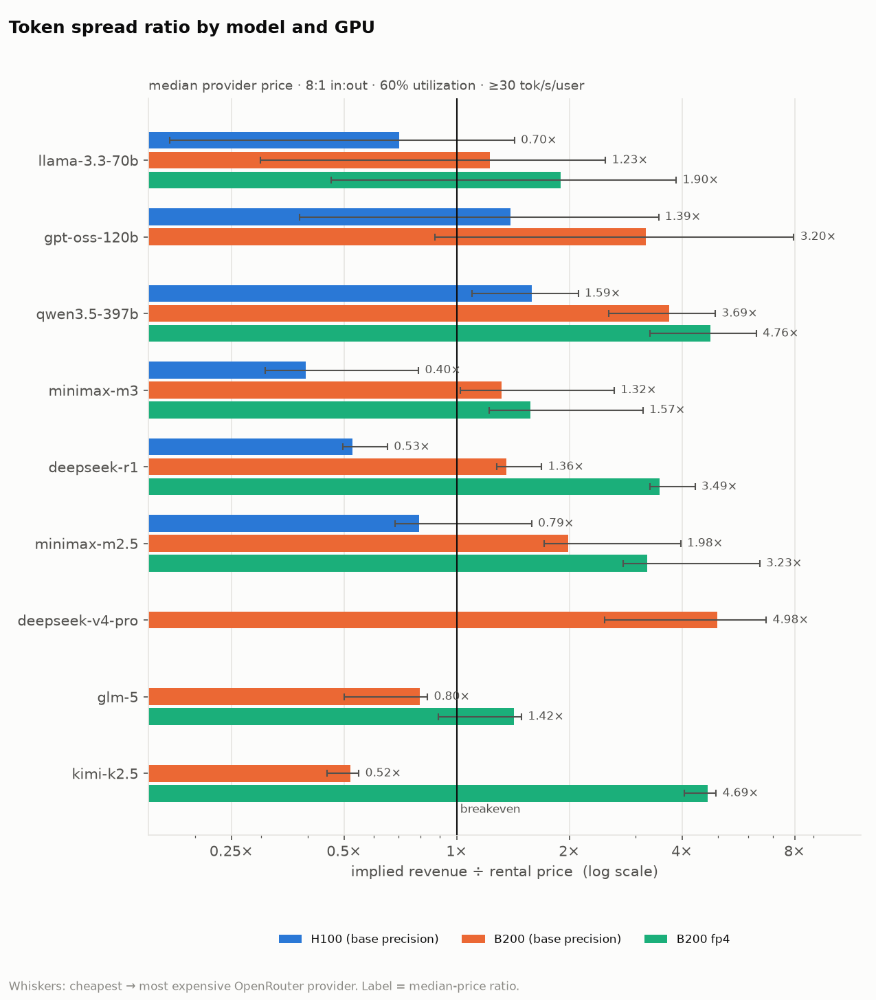
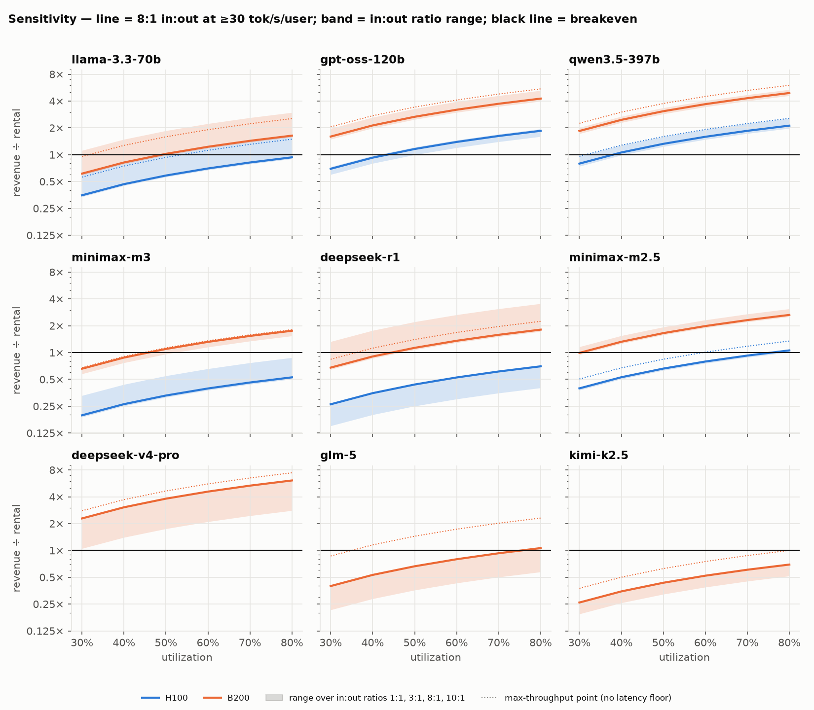
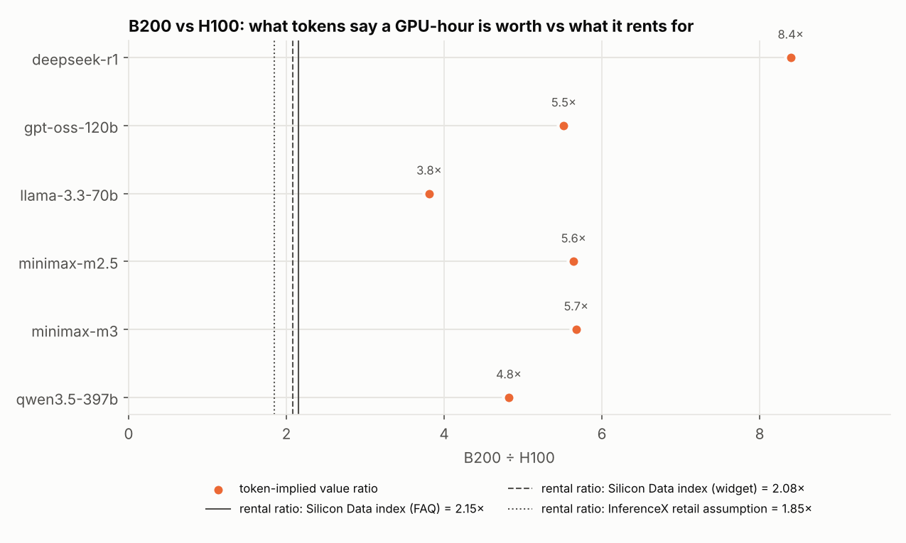
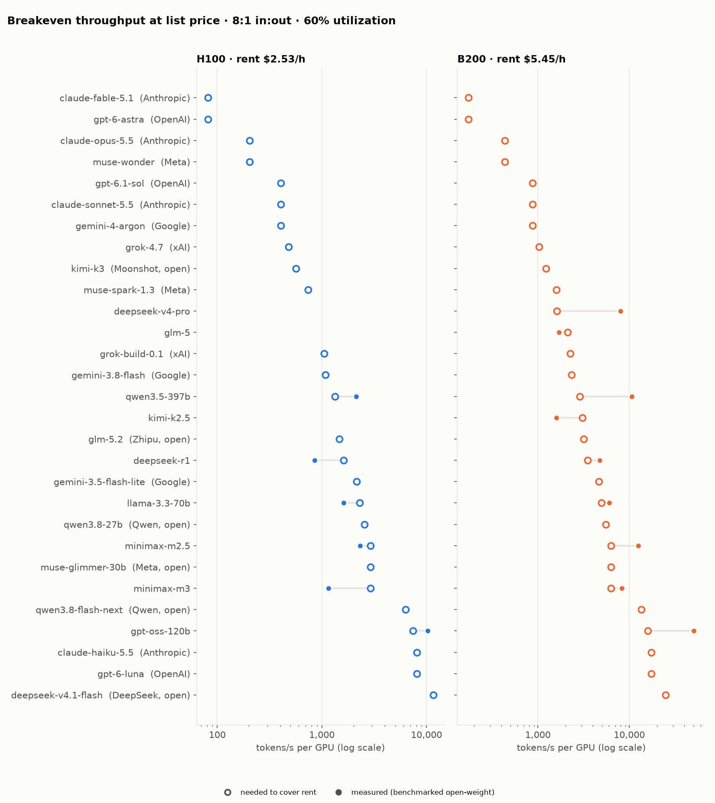
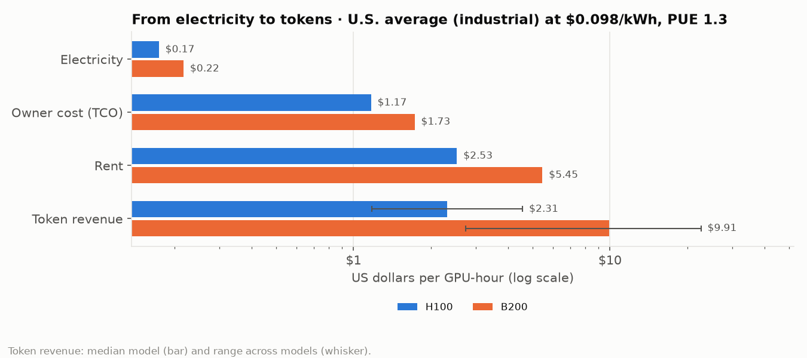
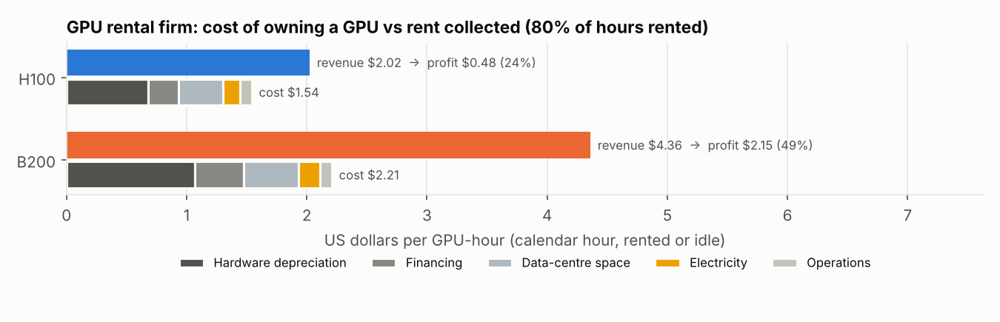

# Token Spread — report 2026-10-13

*Generated by `report.py` from `outputs/` (data retrieved 2026-10-13). Re-run: see README.*

**Question.** What does a GPU-hour earn when it serves open-weight LLM tokens at market API
prices, compared with what that GPU-hour rents for — and does that tell us something rental
indices don't?

**Base assumptions** (`assumptions.yaml`): input:output = 3:1,
utilization = 60%, throughput = best benchmark point with
≥ 30 tok/s per user, price = median
OpenRouter provider, rental = `silicondata_index_faq`.

## Headlines

- Lowest base-case ratio: **deepseek-r1 on H100** at 0.47×
  (breakeven utilization 129%).
- Highest ratio: **qwen3.5-397b on B200 fp4** at 5.99×.
- B200 rents for 2.15× an H100, but at the same precision the token-implied value of a B200-hour is
  3.8×–8.4× an H100-hour, depending on the model (chart 3).

## 1. Summary table

| model | GPU | case | providers | blended $/Mtok (min–med–max) | tok/s/GPU | tok/s/GPU (max) | revenue $/h | rental $/h | spread $/h | ratio | breakeven util | bench date |
|---|---|---|---|---|---|---|---|---|---|---|---|---|
| llama-3.3-70b | H100 fp8 | base | 11 | 0.15–0.64–1.04 | 1851 | 2358 | $2.56 | $2.53 | $0.03 | 1.01× | 59% | 2025-10-29 |
| llama-3.3-70b | B200 fp8 | base | 11 | 0.15–0.64–1.04 | 7050 | 8824 | $9.75 | $5.45 | $4.30 | 1.79× | 34% | 2025-10-29 |
| llama-3.3-70b | B200 fp4 | variant | 11 | 0.15–0.64–1.04 | 10122 | 12032 | $13.99 | $5.45 | $8.54 | 2.57× | 23% | 2025-10-29 |
| gpt-oss-120b | H100 fp4 | base | 24 | 0.06–0.23–0.45 | 7395 | 7395 | $3.69 | $2.53 | $1.16 | 1.46× | 41% | 2026-03-27,2026-05-17 |
| gpt-oss-120b | B200 fp4 | base | 24 | 0.06–0.23–0.45 | 40794 | 48468 | $20.38 | $5.45 | $14.93 | 3.74× | 16% | 2026-02-05,2026-05-18 |
| qwen3.5-397b | H100 fp8 | base | 10 | 0.88–1.29–1.69 | 1640 | 1983 | $4.56 | $2.53 | $2.03 | 1.80× | 33% | 2026-07-05,2026-09-13 |
| qwen3.5-397b | B200 fp8 | base | 10 | 0.88–1.29–1.69 | 7905 | 9141 | $21.98 | $5.45 | $16.53 | 4.03× | 15% | 2026-03-20,2026-07-05,2026-09-18 |
| qwen3.5-397b | B200 fp4 | variant | 10 | 0.88–1.29–1.69 | 11735 | 16027 | $32.63 | $5.45 | $27.18 | 5.99× | 10% | 2026-06-24,2026-09-01 |
| minimax-m3 | H100 fp8 | base | 13 | 0.41–0.52–1.31 | 1096 | 1096 | $1.24 | $2.53 | −$1.29 | 0.49× | 122% | 2026-06-13 |
| minimax-m3 | B200 fp8 | base | 13 | 0.41–0.52–1.31 | 6218 | 6735 | $7.05 | $5.45 | $1.60 | 1.29× | 46% | 2026-06-23,2026-07-29 |
| minimax-m3 | B200 fp4 | variant | 13 | 0.41–0.52–1.31 | 8648 | 10557 | $9.81 | $5.45 | $4.36 | 1.80× | 33% | 2026-07-06,2026-08-04 |
| deepseek-r1 | H100 fp8 | base | 4 | 0.91–0.96–1.15 | 569 | 1098 | $1.18 | $2.53 | −$1.35 | 0.47× | 129% | 2026-02-08,2026-02-13 |
| deepseek-r1 | B200 fp8 | base | 4 | 0.91–0.96–1.15 | 4778 | 6046 | $9.91 | $5.45 | $4.46 | 1.82× | 33% | 2026-02-05,2026-03-23 |
| deepseek-r1 | B200 fp4 | variant | 4 | 0.91–0.96–1.15 | 10974 | 13259 | $22.75 | $5.45 | $17.30 | 4.17× | 14% | 2026-01-29,2026-02-06 |
| minimax-m2.5 | H100 fp8 | base | 9 | 0.44–0.52–1.05 | 1824 | 2160 | $2.07 | $2.53 | −$0.46 | 0.82× | 73% | 2026-03-28,2026-06-04 |
| minimax-m2.5 | B200 fp8 | base | 9 | 0.44–0.52–1.05 | 10290 | 11917 | $11.67 | $5.45 | $6.22 | 2.14× | 28% | 2026-03-28,2026-05-31,2026-06-03 |
| minimax-m2.5 | B200 fp4 | variant | 9 | 0.44–0.52–1.05 | 19251 | 20532 | $21.83 | $5.45 | $16.38 | 4.01× | 15% | 2026-06-03 |
| deepseek-v4-pro | B200 fp4 | base | 15 | 0.55–1.77–3.41 | 5489 | 8544 | $20.99 | $5.45 | $15.54 | 3.85× | 16% | 2026-06-12,2026-08-12 |
| glm-5 | B200 fp8 | base | 8 | 0.93–1.45–1.55 | 1161 | 3572 | $3.64 | $5.45 | −$1.81 | 0.67× | 90% | 2026-03-20,2026-05-18,2026-06-12 |
| glm-5 | B200 fp4 | variant | 8 | 0.93–1.45–1.55 | 2195 | 3486 | $6.88 | $5.45 | $1.43 | 1.26× | 48% | 2026-06-12 |
| kimi-k2.5 | B200 int4 | base | 5 | 0.99–1.14–1.23 | 1112 | 1484 | $2.74 | $5.45 | −$2.71 | 0.50× | 119% | 2026-03-24,2026-07-05,2026-07-18 |
| kimi-k2.5 | B200 fp4 | variant | 5 | 0.99–1.14–1.23 | 8572 | 9752 | $21.11 | $5.45 | $15.66 | 3.87× | 15% | 2026-03-27,2026-06-07,2026-07-22 |

`tok/s/GPU` = total (input+output) tokens/s per GPU at the base in:out ratio, interactivity-floor
point; `(max)` = highest throughput with no latency floor. Breakeven util = utilization at
which revenue = rental. Rows with `estimate=True` in `outputs/spread_summary.csv` use
interpolated throughput (see section 10).

## 2. Sensitivity: utilization × input:output ratio

Full grid (also with the max-throughput operating point): `outputs/sensitivity.csv`.

## 3. B200 vs H100 relative value

If rental markets priced GPUs by the tokens they produce, the dots would sit on the rental-ratio
lines. Dots to the right mean B200 is cheap relative to H100 for that model (or H100 is dear).

## 4. Provider dispersion (base case, one rental price, many API prices)

| model | GPU | cheapest provider | most expensive | providers above breakeven |
|---|---|---|---|---|
| deepseek-r1 | B200 | DeepInfra (fp4) 1.73× | Novita (fp8) 2.18× | 4/4 |
| deepseek-r1 | H100 | DeepInfra (fp4) 0.44× | Novita (fp8) 0.56× | 0/4 |
| deepseek-v4-pro | B200 | StreamLake (fp8) 1.19× | Reka (unknown) 7.42× | 15/15 |
| glm-5 | B200 | GMICloud (fp8) 0.43× | Amazon Bedrock (unknown) 0.71× | 0/8 |
| gpt-oss-120b | B200 | Venice (int4) 0.97× | Cerebras (fp16) 7.28× | 23/24 |
| gpt-oss-120b | H100 | Venice (int4) 0.38× | Cerebras (fp16) 2.84× | 14/24 |
| kimi-k2.5 | B200 | AtlasCloud (int4) 0.44× | Venice (unknown) 0.54× | 0/5 |
| llama-3.3-70b | B200 | DeepInfra (fp8) 0.43× | Together (unknown) 2.91× | 7/11 |
| llama-3.3-70b | H100 | DeepInfra (fp8) 0.24× | Together (unknown) 1.64× | 6/11 |
| minimax-m2.5 | B200 | Venice (unknown) 1.79× | Minimax (fp8) 4.28× | 9/9 |
| minimax-m2.5 | H100 | Venice (unknown) 0.69× | Minimax (fp8) 1.64× | 1/9 |
| minimax-m3 | B200 | CoreWeave (fp4) 1.02× | ModelRun (fp4) 3.23× | 13/13 |
| minimax-m3 | H100 | CoreWeave (fp4) 0.39× | ModelRun (fp4) 1.23× | 1/13 |
| qwen3.5-397b | B200 | Alibaba (unknown) 2.75× | Venice (unknown) 5.29× | 10/10 |
| qwen3.5-397b | H100 | Alibaba (unknown) 1.23× | Venice (unknown) 2.36× | 10/10 |

Full table: `outputs/provider_spread.csv`.

## 5. Rental prices used

| gpu | series | price | method | estimate | notes |
|---|---|---|---|---|---|
| h100 | silicondata_index_faq | $2.53 | scraped | False | FAQ text on index page (SDH100RT, neocloud on-demand) |
| h100 | silicondata_index_widget | $2.85 | scraped | False | 'Related indices' widget, ticker SDH100RT, 7D change 7.1% |
| b200 | silicondata_index_faq | $5.45 | scraped | False | FAQ text on index page (SDB200RT, neocloud on-demand) |
| b200 | silicondata_index_widget | $5.95 | scraped | False | 'Related indices' widget, ticker SDB200RT, 7D change 4.0% |
| h100 | inferencex_retail | $2.00 | fetched | True | InferenceX 'retail tier' $/GPU-hr assumption (SemiAnalysis TCO model); modelled, not a market quote |
| h100 | inferencex_owner_tco | $1.17 | fetched | True | InferenceX 'owning at hyperscaler volume' $/GPU-hr (all-in TCO, not a rental price); modelled, not a market quote |
| b200 | inferencex_retail | $3.70 | fetched | True | InferenceX 'retail tier' $/GPU-hr assumption (SemiAnalysis TCO model); modelled, not a market quote |
| b200 | inferencex_owner_tco | $1.73 | fetched | True | InferenceX 'owning at hyperscaler volume' $/GPU-hr (all-in TCO, not a rental price); modelled, not a market quote |

## 6. Price-only models: breakeven throughput and price comparison

Closed models (Claude, GPT, Grok) publish prices but not their hardware or throughput, and some
open-weight models have no comparable benchmark yet (only agentic traces, or no runs). No
spread is computed for them. Instead: how many tokens/s per GPU would a model need for its
**list price** to cover the GPU's rent at 60% utilization?
`needed = rent ÷ (3600 × utilization × blended price / 1e6)`. For open-weight models this is
the same breakeven, and spread ratio = measured ÷ needed.

- **claude-fable-5.1** at $20.00/Mtok needs only **59 tok/s per H100**.
  The slowest open-weight model measured here manages 569.
- **deepseek-v4.1-flash** at $0.19/Mtok needs **6,146 tok/s per H100**
  (13,240 per B200). 1 of 6.0 benchmarked models reaches that on H100.
- These are thresholds, not estimates of closed-model throughput or margin. Closed labs may
  run other hardware (TPUs, Trainium, own clusters), bill hidden reasoning tokens as output,
  and discount cached input heavily.

| model | lab | weights | blended $/Mtok | needed tok/s per H100 | needed tok/s per B200 | benchmarked models above (H100, of 6.0) | benchmarked models above (B200, of 9.0) |
|---|---|---|---|---|---|---|---|
| claude-fable-5.1 | Anthropic | closed | $20.00 | 59 | 126 | 6 | 9 |
| gpt-6-astra | OpenAI | closed | $20.00 | 59 | 126 | 6 | 9 |
| claude-opus-5.5 | Anthropic | closed | $8.00 | 146 | 315 | 6 | 9 |
| claude-sonnet-5.5 | Anthropic | closed | $4.00 | 293 | 631 | 6 | 9 |
| gpt-6.1-sol | OpenAI | closed | $4.00 | 293 | 631 | 6 | 9 |
| kimi-k3 | Moonshot | open | $3.05 | 384 | 828 | 6 | 9 |
| grok-4.7 | xAI | closed | $3.00 | 390 | 841 | 6 | 9 |
| glm-5.2 | Zhipu | open | $1.79 | 653 | 1,406 | 5 | 7 |
| grok-build-0.1 | xAI | closed | $1.25 | 937 | 2,019 | 5 | 7 |
| qwen3.8-27b | Qwen | open | $0.60 | 1,936 | 4,170 | 1 | 7 |
| qwen3.8-flash-next | Qwen | open | $0.23 | 5,093 | 10,970 | 1 | 1 |
| claude-haiku-5.5 | Anthropic | closed | $0.20 | 5,856 | 12,616 | 1 | 1 |
| gpt-6-luna | OpenAI | closed | $0.20 | 5,856 | 12,616 | 1 | 1 |
| deepseek-v4.1-flash | DeepSeek | open | $0.19 | 6,146 | 13,240 | 1 | 1 |

**Price comparison** (blended at 3:1; price-only = OpenRouter list price,
benchmarked open-weight = median provider):

| model | weights | analysis | lab | blended $/Mtok | endpoint range | basis |
|---|---|---|---|---|---|---|
| claude-fable-5.1 | closed | price-only | Anthropic | $20.000 | $20.000–$20.000 | OpenRouter list price |
| gpt-6-astra | closed | price-only | OpenAI | $20.000 | $10.000–$120.000 | OpenRouter list price |
| claude-opus-5.5 | closed | price-only | Anthropic | $8.000 | $8.000–$16.000 | OpenRouter list price |
| claude-sonnet-5.5 | closed | price-only | Anthropic | $4.000 | $4.000–$4.400 | OpenRouter list price |
| gpt-6.1-sol | closed | price-only | OpenAI | $4.000 | $2.000–$24.000 | OpenRouter list price |
| kimi-k3 | open | price-only | Moonshot | $3.047 | $3.047–$9.000 | OpenRouter list price |
| grok-4.7 | closed | price-only | xAI | $3.000 | $3.000–$6.000 | OpenRouter list price |
| glm-5.2 | open | price-only | Zhipu | $1.795 | $0.625–$4.125 | OpenRouter list price |
| deepseek-v4-pro | open | spread | open-weight | $1.770 | $0.545–$3.413 | median OpenRouter provider |
| glm-5 | open | spread | open-weight | $1.450 | $0.930–$1.550 | median OpenRouter provider |
| qwen3.5-397b | open | spread | open-weight | $1.288 | $0.877–$1.688 | median OpenRouter provider |
| grok-build-0.1 | closed | price-only | xAI | $1.250 | $1.250–$2.500 | OpenRouter list price |
| kimi-k2.5 | open | spread | open-weight | $1.140 | $0.993–$1.230 | median OpenRouter provider |
| deepseek-r1 | open | spread | open-weight | $0.960 | $0.912–$1.150 | median OpenRouter provider |
| llama-3.3-70b | open | spread | open-weight | $0.640 | $0.155–$1.040 | median OpenRouter provider |
| qwen3.8-27b | open | price-only | Qwen | $0.605 | $0.342–$1.138 | OpenRouter list price |
| minimax-m3 | open | spread | open-weight | $0.525 | $0.412–$1.312 | median OpenRouter provider |
| minimax-m2.5 | open | spread | open-weight | $0.525 | $0.440–$1.050 | median OpenRouter provider |
| gpt-oss-120b | open | spread | open-weight | $0.231 | $0.060–$0.450 | median OpenRouter provider |
| qwen3.8-flash-next | open | price-only | Qwen | $0.230 | $0.230–$0.230 | OpenRouter list price |
| claude-haiku-5.5 | closed | price-only | Anthropic | $0.200 | $0.200–$0.220 | OpenRouter list price |
| gpt-6-luna | closed | price-only | OpenAI | $0.200 | $0.100–$0.400 | OpenRouter list price |
| deepseek-v4.1-flash | open | price-only | DeepSeek | $0.191 | $0.113–$1.050 | OpenRouter list price |

## 7. From electricity to tokens

A GPU-hour's cost starts with electricity. Each GPU draws its **all-in** power (chip plus its
share of host CPU, memory and network; SemiAnalysis: H100 1.37 kW,
B200 1.71 kW), and the facility adds cooling and conversion losses
(PUE 1.3). `power cost per GPU-hour = all-in kW × load factor (1.0) × PUE × $/kWh`.

At the base region (U.S. average (industrial), $0.098/kWh):

- Electricity costs **$0.17 per H100-hour** and
  **$0.22 per B200-hour**: 6.9%
  and 4.0% of the rent, and about
  15% / 13% of the owner's full cost (SemiAnalysis TCO).
- Across regions ($0.071–$0.201/kWh),
  power is 2.9%–14.2% of rent.
- Turned into tokens and sold at market prices, one kWh earns
  $0.66–$9.89: **7–101×**
  what the electricity cost.
- Measured GPU draw (newer InferenceX runs only) is 72%–92% of
  TDP at the chosen operating points, so the full-load assumption is conservative.

| model | GPU | power $/h | owner TCO $/h | rent $/h | revenue $/h | tokens per kWh | revenue per kWh | revenue ÷ power | measured GPU W (% TDP) |
|---|---|---|---|---|---|---|---|---|---|
| llama-3.3-70b | H100 fp8 | $0.17 | $1.17 | $2.53 | $2.56 | 2.24M | $1.44 | 15× | – |
| llama-3.3-70b | B200 fp8 | $0.22 | $1.73 | $5.45 | $9.75 | 6.85M | $4.38 | 45× | – |
| gpt-oss-120b | H100 fp4 | $0.17 | $1.17 | $2.53 | $3.69 | 8.97M | $2.07 | 21× | – |
| gpt-oss-120b | B200 fp4 | $0.22 | $1.73 | $5.45 | $20.38 | 39.64M | $9.17 | 94× | – |
| qwen3.5-397b | H100 fp8 | $0.17 | $1.17 | $2.53 | $4.56 | 1.99M | $2.56 | 26× | 503 (72%) |
| qwen3.5-397b | B200 fp8 | $0.22 | $1.73 | $5.45 | $21.98 | 7.68M | $9.89 | 101× | 921 (92%) |
| minimax-m3 | H100 fp8 | $0.17 | $1.17 | $2.53 | $1.24 | 1.33M | $0.70 | 7× | 583 (83%) |
| minimax-m3 | B200 fp8 | $0.22 | $1.73 | $5.45 | $7.05 | 6.04M | $3.17 | 32× | 829 (83%) |
| deepseek-r1 | H100 fp8 | $0.17 | $1.17 | $2.53 | $1.18 | 0.69M | $0.66 | 7× | – |
| deepseek-r1 | B200 fp8 | $0.22 | $1.73 | $5.45 | $9.91 | 4.64M | $4.46 | 46× | – |
| minimax-m2.5 | H100 fp8 | $0.17 | $1.17 | $2.53 | $2.07 | 2.21M | $1.16 | 12× | 519 (74%) |
| minimax-m2.5 | B200 fp8 | $0.22 | $1.73 | $5.45 | $11.67 | 10.00M | $5.25 | 54× | – |
| deepseek-v4-pro | B200 fp4 | $0.22 | $1.73 | $5.45 | $20.99 | 5.33M | $9.44 | 97× | – |
| glm-5 | B200 fp8 | $0.22 | $1.73 | $5.45 | $3.64 | 1.13M | $1.64 | 17× | – |
| kimi-k2.5 | B200 int4 | $0.22 | $1.73 | $5.45 | $2.74 | 1.08M | $1.23 | 13× | 788 (79%) |

**Electricity cost per GPU-hour by region** (EIA: latest month, by sector; Eurostat:
MWH70000-149999 kWh/yr band, excl. VAT, converted at the ECB rate):

| region | $/kWh | period | H100 power $/h | B200 power $/h | share of H100 rent | share of B200 rent |
|---|---|---|---|---|---|---|
| Texas | $0.071 | July 2026 | $0.13 | $0.16 | 5.0% | 2.9% |
| Washington | $0.075 | July 2026 | $0.13 | $0.17 | 5.3% | 3.1% |
| Norway | $0.080 | 2026-S1 | $0.14 | $0.18 | 5.6% | 3.2% |
| Finland | $0.089 | 2026-S1 | $0.16 | $0.20 | 6.2% | 3.6% |
| France | $0.089 | 2026-S1 | $0.16 | $0.20 | 6.3% | 3.6% |
| Oregon | $0.089 | July 2026 | $0.16 | $0.20 | 6.3% | 3.6% |
| Arizona | $0.093 | July 2026 | $0.17 | $0.21 | 6.6% | 3.8% |
| U.S. average (industrial) | $0.098 | July 2026 | $0.17 | $0.22 | 6.9% | 4.0% |
| Georgia | $0.100 | July 2026 | $0.18 | $0.22 | 7.1% | 4.1% |
| Sweden | $0.100 | 2026-S1 | $0.18 | $0.22 | 7.1% | 4.1% |
| Virginia | $0.101 | July 2026 | $0.18 | $0.22 | 7.1% | 4.1% |
| Spain | $0.103 | 2026-S1 | $0.18 | $0.23 | 7.2% | 4.2% |
| Ohio | $0.110 | July 2026 | $0.20 | $0.24 | 7.7% | 4.5% |
| Netherlands | $0.140 | 2026-S1 | $0.25 | $0.31 | 9.9% | 5.7% |
| U.S. average (commercial) | $0.145 | July 2026 | $0.26 | $0.32 | 10.2% | 5.9% |
| Germany | $0.154 | 2026-S1 | $0.27 | $0.34 | 10.9% | 6.3% |
| Ireland | $0.201 | 2026-S1 | $0.36 | $0.45 | 14.2% | 8.2% |

## 8. Who makes the money: the GPU rental firm

Electricity is not most of a GPU rental firm's cost. Owning a GPU for one hour costs:
`hardware (depreciation + financing) + data-centre space + electricity + operations`.
Hardware and its financing are 59%–65% of the total.
The firm collects rent only for the share of hours a customer is using the GPU (occupancy,
80% here).

| per GPU-hour | H100 | B200 |
|---|---|---|
| Hardware depreciation | $0.68 | $1.07 |
| Financing | $0.23 | $0.36 |
| Data-centre space | $0.37 | $0.46 |
| Electricity | $0.17 | $0.22 |
| Operations | $0.10 | $0.10 |
| **Full cost** | $1.55 | $2.21 |
| Revenue (rent × 80%) | $2.02 | $4.36 |
| **Profit** | $0.48 | $2.15 |
| Margin before depreciation & interest (EBITDA) | 68% | 82% |
| Operating margin | 35% | 58% |
| Net margin | 23% | 49% |
| Occupancy needed to break even | 61% | 41% |
| Payback on hardware (years) | 2.9 | 1.8 |
| SemiAnalysis owner cost (cross-check) | $1.17 | $1.73 |

Assumptions (`assumptions.yaml` → `rental_firm`): capex per GPU = 8-GPU server ÷ 8, straight-line
over 6 years, financed at 9% (annuity), colocation
$196.25/kW-month on all-in kW, operations $0.10/GPU-hour.

**Profit by occupancy** (6-year depreciation):

| occupancy | H100 profit $/h | B200 profit $/h |
|---|---|---|
| 50% | −$0.28 | $0.52 |
| 60% | −$0.03 | $1.06 |
| 70% | $0.22 | $1.61 |
| 80% | $0.48 | $2.15 |
| 90% | $0.73 | $2.70 |
| 100% | $0.98 | $3.24 |

**Reality check: CoreWeave, Q2 2026.** Revenue $2,575M; adjusted EBITDA
margin 59%; depreciation 54%
and interest 25% of revenue; operating margin
-2%. The model's EBITDA margins are in the same range, but its
operating margins are far higher. A fast-growing firm pays depreciation and interest on capacity
before it earns revenue, sells mostly on multi-year contracts below on-demand prices, and carries
overheads (sales, R&D, stock compensation) that this per-GPU model leaves out.

**Where one rented GPU-hour of token revenue goes** (base cases): the GPU landlord's costs and
profit add up to the rent; the inference provider keeps token revenue minus rent (the token
spread). An operator that owns its GPUs and sells tokens keeps token revenue minus full cost.

| model | GPU | landlord costs $/h | landlord profit $/h | rent $/h | token revenue $/h | inference provider profit $/h | own-and-serve profit $/h | full cost per M tokens | price per M tokens |
|---|---|---|---|---|---|---|---|---|---|
| llama-3.3-70b | H100 | $1.94 | $0.59 | $2.53 | $2.56 | $0.03 | $1.01 | $0.388 | $0.640 |
| llama-3.3-70b | B200 | $2.76 | $2.69 | $5.45 | $9.75 | $4.30 | $7.54 | $0.145 | $0.640 |
| gpt-oss-120b | H100 | $1.94 | $0.59 | $2.53 | $3.69 | $1.16 | $2.15 | $0.097 | $0.231 |
| gpt-oss-120b | B200 | $2.76 | $2.69 | $5.45 | $20.38 | $14.93 | $18.17 | $0.025 | $0.231 |
| qwen3.5-397b | H100 | $1.94 | $0.59 | $2.53 | $4.56 | $2.03 | $3.01 | $0.437 | $1.288 |
| qwen3.5-397b | B200 | $2.76 | $2.69 | $5.45 | $21.98 | $16.53 | $19.78 | $0.129 | $1.288 |
| minimax-m3 | H100 | $1.94 | $0.59 | $2.53 | $1.24 | −$1.29 | −$0.31 | $0.654 | $0.525 |
| minimax-m3 | B200 | $2.76 | $2.69 | $5.45 | $7.05 | $1.60 | $4.84 | $0.164 | $0.525 |
| deepseek-r1 | H100 | $1.94 | $0.59 | $2.53 | $1.18 | −$1.35 | −$0.37 | $1.260 | $0.960 |
| deepseek-r1 | B200 | $2.76 | $2.69 | $5.45 | $9.91 | $4.46 | $7.70 | $0.214 | $0.960 |
| minimax-m2.5 | H100 | $1.94 | $0.59 | $2.53 | $2.07 | −$0.46 | $0.52 | $0.393 | $0.525 |
| minimax-m2.5 | B200 | $2.76 | $2.69 | $5.45 | $11.67 | $6.22 | $9.46 | $0.099 | $0.525 |
| deepseek-v4-pro | B200 | $2.76 | $2.69 | $5.45 | $20.99 | $15.54 | $18.78 | $0.186 | $1.770 |
| glm-5 | B200 | $2.76 | $2.69 | $5.45 | $3.64 | −$1.81 | $1.43 | $0.881 | $1.450 |
| kimi-k2.5 | B200 | $2.76 | $2.69 | $5.45 | $2.74 | −$2.71 | $0.53 | $0.920 | $1.140 |

**Sources used in the firm model:**

| item | gpu | value | unit | low | high | estimate | source |
|---|---|---|---|---|---|---|---|
| server_price_8gpu | h100 | 285000.0 | USD per 8-GPU server | 250000.0 | 320000.0 | True | [link](https://www.mercatus-ai.com/blog/h100-server-price) |
| server_price_8gpu | b200 | 450000.0 | USD per 8-GPU server | 400000.0 | 500000.0 | True | [link](https://www.mercatus-ai.com/blog/b200-server-price) |
| depreciation_years | all | 6.0 | years | 4.0 | 6.0 | True | [link](https://capefearadvisors.substack.com/p/the-second-contract) |
| cost_of_capital | all | 0.09 | annual rate | 0.059 | 0.15 | True | [link](https://longyield.substack.com/p/coreweave-can-its-gpus-repay-the) |
| colocation_per_kw_month | all | 196.25 | USD per kW-month | 165.0 | 235.0 | False | [link](https://www.cbre.com/insights/books/north-america-data-center-trends-h2-2025) |
| ops_per_gpu_hour | all | 0.1 | USD per GPU-hour | 0.07 | 0.15 | True | [link](https://www.mercatus-ai.com/blog/h100-server-price) |
| occupancy | all | 0.8 | share of hours rented | 0.5 | 1.0 | True | [link](https://www.mercatus-ai.com/blog/h100-server-price) |

## 9. Over time

Only one snapshot so far; the time-series chart appears after the second daily run.

## 10. Data gaps and caveats

**Gaps found this run**

- **llama-3.3-70b on H100**: newest benchmark is 2025-10-29 (>6 months old; software has improved since, so throughput is likely understated).
- **llama-3.3-70b on B200**: newest benchmark is 2025-10-29 (>6 months old; software has improved since, so throughput is likely understated).
- **deepseek-r1 on H100**: newest benchmark is 2026-02-13 (>6 months old; software has improved since, so throughput is likely understated).
- **deepseek-r1 on B200**: newest benchmark is 2026-03-23 (>6 months old; software has improved since, so throughput is likely understated).
- **deepseek-v4-pro on H100**: no InferenceX benchmark on this GPU; the model appears on the other GPU only.
- **deepseek-v4-pro on B200**: benchmarked at fp4, but most providers report serving fp8.
- **glm-5 on H100**: no InferenceX benchmark on this GPU; the model appears on the other GPU only.
- **kimi-k2.5 on H100**: no InferenceX benchmark on this GPU; the model appears on the other GPU only.
- **Sweep edges:** 12 of 30 chosen benchmark points are the last point of their concurrency sweep and still well above the speed floor. The benchmark stopped before reaching the floor, so throughput there is a lower bound.
- **deepseek-v4.1-flash** (open-weight): agentic benchmarks only; shown as price-only.
- **kimi-k3** (open-weight): agentic benchmarks only; shown as price-only.
- **glm-5.2** (open-weight): agentic benchmarks only; shown as price-only.
- **qwen3.8-flash-next** (open-weight): agentic benchmarks only; shown as price-only.
- **qwen3.8-27b** (open-weight): no benchmark runs yet; shown as price-only.
- **No 8B-class model**: InferenceX doesn't benchmark one, so there is no comparable throughput.
- Providers with **unknown quantization** on OpenRouter: deepseek-r1 1, deepseek-v4-pro 5, glm-5 1, gpt-oss-120b 9, kimi-k2.5 3, llama-3.3-70b 5, minimax-m2.5 4, minimax-m3 3, qwen3.5-397b 6.
  They are included in the price statistics regardless of precision.

**Caveats**

- **Throughput dominates.** The interactivity floor alone moves results by up to several ×
  (compare `tok/s/GPU` with `(max)`). Benchmarks use random tokens and fixed lengths, with no
  prefix-cache hits, no traffic burstiness and no long-context tail.
- **3:1 and 10:1 ratios are not measured.** InferenceX measures 1k/1k (1:1) and 8k/1k (8:1).
  3:1 is log-interpolated and 10:1 is held at 8:1. The 1:1 and 8:1 points can come from
  different dates and software versions.
- **Configurations differ across GPUs.** The best point may use speculative decoding (MTP) on
  one GPU and not the other, and some points (e.g. DeepSeek-R1 on H100) need multi-node
  disaggregated serving. These are the best published configurations, not matched ones.
- **Prices are list prices.** OpenRouter shows public per-token prices only, without volume
  deals, batch discounts or cache-hit pricing. Precision is not matched per provider: the
  median is across all providers, and an fp4 provider counts the same as a bf16 one.
- **Rental is neocloud on-demand.** Silicon Data's public page shows two different readings
  (FAQ vs widget; both are recorded). Term contracts and hyperscalers price differently.
  InferenceX's owner-TCO figures (H100 $1.17,
  B200 $1.73) are a floor for what serving
  costs an owner-operator.
- **Electricity is modelled, not metered.** Power cost uses SemiAnalysis all-in kW per GPU at
  full load, an assumed PUE and average published tariffs. Large operators buy power through
  contracts (PPAs) whose prices are not public, and pay demand charges not captured here.
- **The rental-firm model is generic.** Server prices are vendor estimates (NVIDIA publishes no
  list price), depreciation life and financing cost vary by firm, and real fleets mix contract
  and on-demand prices. It leaves out sales, R&D and corporate overheads.
- **Revenue ≠ margin.** The spread excludes networking, storage, CPU hosts, engineering,
  idle capacity reserved for peaks, and OpenRouter's fee.
